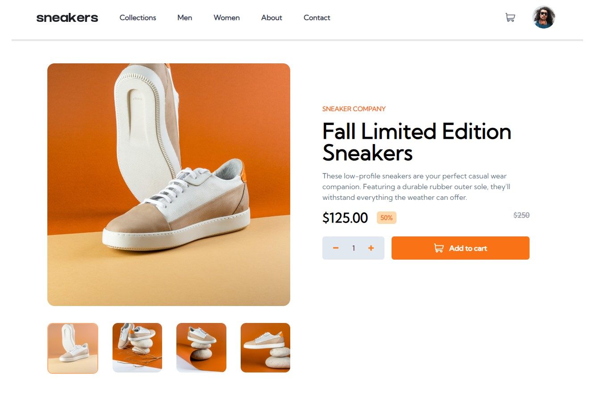

# E-commerce Product Page

A responsive product page for a sneaker store, with an image gallery and a working shopping cart. Built as a solution to the [Frontend Mentor E-commerce product page challenge](https://www.frontendmentor.io/challenges/ecommerce-product-page-UPsZ9MJp6).

**[Live demo](https://ecommerce-frontentmentor-astilion.netlify.app/)**



## Features

- **Image gallery**: slider with arrow buttons on mobile, and a thumbnail strip with a lightbox on desktop
- **Shopping cart**: add products in any quantity, remove items one by one, live item counter with a small "bump" animation
- **Discounted pricing**: the final price is calculated from the base price and discount
- **Responsive layout**: mobile-first, with a slide-in navigation menu on small screens
- **Keyboard and screen reader support**: arrow keys and Escape in the lightbox, Escape or click outside to close the cart, ARIA labels on icon buttons
- **Animations**: cart dropdown animated with Framer Motion

## Tech stack


## Getting started

Requires **Node.js 18+**.

```sh
git clone https://github.com/Astilion/E-commerce-product-page.git
cd E-commerce-product-page
npm install
npm run dev
```

| Script | Description |
| --- | --- |
| `npm run dev` | Start the development server |
| `npm run build` | Type-check and build for production |
| `npm run preview` | Preview the production build |
| `npm run lint` | Run ESLint |
| `npm test` | Run unit tests (Vitest) |

## Project structure

```
src/
├── components/
│   ├── layout/        # Header, Footer, page wrapper
│   ├── navigation/    # Desktop and mobile navigation
│   ├── cart/          # Cart button, dropdown and cart items
│   ├── product/
│   │   ├── gallery/   # Image slider, thumbnails, lightbox
│   │   └── details/   # Product info, pricing, quantity control
│   └── ui/            # Reusable Modal and icons
├── data/              # Product data
├── hooks/             # useMediaQuery / useIsMobile
├── store/             # Redux store, cart slice, typed hooks
├── types/             # Shared TypeScript types
└── utils/             # Price and string helpers
```

## Key decisions

- **Redux Toolkit for the cart.** The cart state is shared between the product section (adding items) and the header (counter and dropdown). The reducer logic is covered by unit tests.
- **Product data separated from components.** Components receive the product through props, so adding more products later only means adding data.
- **Responsive behaviour through `matchMedia`.** The `useIsMobile` hook uses `useSyncExternalStore` instead of a `resize` listener, so it only updates when the breakpoint actually changes
- **Lightbox rendered in a portal.** The gallery modal is rendered with `createPortal` outside the main layout, which avoids z-index and overflow issues.

## Possible improvements

- Swipe gestures for the mobile slider
- Persisting the cart in `localStorage`
- Component tests with React Testing Library
- Focus trap inside the lightbox

## Author

Mateusz Kamiński: [GitHub](https://github.com/Astilion) · mkaminski.contact@gmail.com
